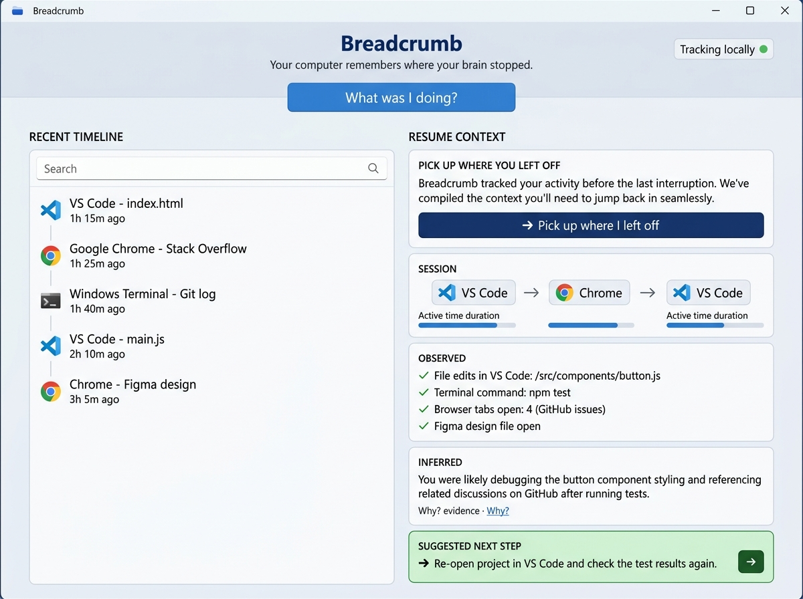
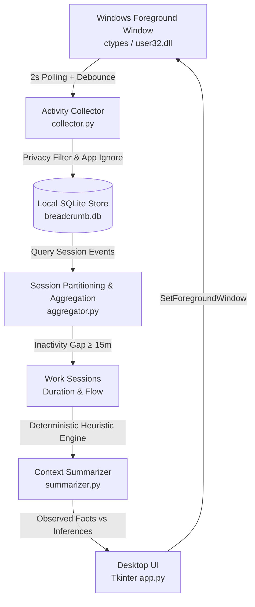

# Breadcrumb

### Your computer remembers where your brain stopped.

Modern knowledge work involves constant multitasking across code editors, documentation tabs, terminals, and communication tools. After an interruption—a meeting, a message, or simply stepping away—developers frequently remember that they were working on something, but lose the precise train of thought and context.

Breadcrumb is a lightweight, local-first desktop utility for Windows that captures foreground activity transitions, partitions them into cohesive work sessions, and reconstructs an explainable summary of where you left off so you can immediately resume flow.



---

## Problem

When developers get pulled away from their desks or context-switch between tasks, returning to the machine incurs severe cognitive re-orientation overhead:
* *Which file was I editing last?*
* *What test or terminal command did I just run?*
* *Which reference tab was relevant to that exact line of code?*

Existing productivity tools either demand tedious manual task logging (which developers abandon) or invasively record full video streams and keylogs (raising major privacy and performance concerns).

## Solution

Breadcrumb takes a minimalist, privacy-first approach. Instead of recording content, screen pixels, or keystrokes, it polls lightweight operating system window metadata: active window titles, process names, and timestamps.

By grouping these events across periods of user inactivity, Breadcrumb detects discrete **Work Sessions**, computes approximate active time per application, and separates verified system telemetry from heuristic intent deductions—giving you a 1-click summary and focus restoration.

## Why I Built It

The goal was not to build another task manager, AI assistant, or dashboard.

The engineering insight behind Breadcrumb was to test whether non-invasive, low-overhead OS signals—collected without recording keystrokes or taking screenshots—could be transformed into genuinely actionable work-context recovery. By treating window transitions as a lightweight trail of breadcrumbs, we can answer "Where was I?" deterministically, transparently, and 100% locally.

---

## Features

Only fully implemented capabilities are included:

* **Local Activity Tracking**: Lightweight background poller capturing active window titles and process executables via the Windows API (`user32.dll`).
* **Work-Session Detection**: Partitions raw transitions into distinct sessions separated by configurable inactivity thresholds (default: 15 minutes).
* **Recent Activity Timeline**: Chronological, searchable feed of transitions grouped by work sessions.
* **Application Activity & Time Metrics**: Calculates approximate active duration and event counts per application (e.g. `VS Code 24m`, `Chrome 5m`).
* **Resume Context Generation**: Generates a unified overview answering what you were doing, last active file, and recommended next action.
* **Strict Observed vs. Inferred Separation**: Clearly distinguishes ground-truth system telemetry (`OBSERVED`) from heuristic deductions (`INFERRED`).
* **Explainable Evidence (`[Why?]`)**: Every inference exposes the concrete evidence trail that produced it.
* **One-Click Window Restoration**: The `[ ➜ Pick up where I left off ]` action safely foregrounds your last active editor or window.
* **Privacy Controls & Sanitization**: Automatically masks titles containing passwords, banking keywords, or private browsing modes.
* **Ignored Applications**: Custom ignore list (e.g., Spotify, WhatsApp) managed via UI dialog and saved to `settings.json`.
* **Copyable Resume Context**: Exports clean Markdown formatted for ChatGPT, Claude, Slack, or personal work logs.
* **Deterministic Console & GUI Demo Mode**: Pre-loaded multi-session scenarios for immediate evaluation without recording real user history.

---

## How It Works



1. **Activity Collector** (`collector.py`): Polls the active foreground window handle every 2 seconds via `GetForegroundWindow` and `GetWindowTextW`. Duplicate transitions are debounced in-memory.
2. **Privacy Guard & Parser** (`parser.py`): Checks window titles against sensitive keyword lists (passwords, banks, incognito). Masks sensitive titles immediately. Extracts filenames, workspaces, web domains, and commands.
3. **Local Event Store** (`storage.py`): Persists sanitized event records in an embedded SQLite database (`breadcrumb.db`).
4. **Session Aggregator** (`aggregator.py`): Collapses micro-switches and partitions event sequences into discrete work sessions based on an inactivity gap (15 minutes). Computes active time per app and chronological flow (`VS Code → Chrome → Terminal`).
5. **Context Summarizer** (`summarizer.py`): Applies deterministic heuristic rules to identify the primary task, list verified facts, generate explainable deductions, and suggest the next step.
6. **Desktop Application** (`app.py`): Native, responsive desktop GUI built with Python Tkinter.

---

## Architecture

| File | Purpose |
|---|---|
| [`run.py`](run.py) | CLI entry point supporting desktop GUI launch, console demo, status inspection, and database wiping. |
| [`config.py`](config.py) | Central configuration (polling interval, inactivity threshold, privacy keywords, ignored apps). |
| [`breadcrumb/collector.py`](breadcrumb/collector.py) | Background thread polling active window and process metadata via Windows `ctypes`. |
| [`breadcrumb/parser.py`](breadcrumb/parser.py) | Entity extractor, process resolver, and privacy sanitization filter. |
| [`breadcrumb/storage.py`](breadcrumb/storage.py) | Local SQLite persistence layer (`activity_events` table with index). |
| [`breadcrumb/aggregator.py`](breadcrumb/aggregator.py) | Inactivity-based session clustering, duration calculation, and timeline search. |
| [`breadcrumb/summarizer.py`](breadcrumb/summarizer.py) | Deterministic rule-based resume context generator with explainability. |
| [`breadcrumb/demo_data.py`](breadcrumb/demo_data.py) | Synthetic multi-session test data for demonstration and unit tests. |
| [`breadcrumb/app.py`](breadcrumb/app.py) | Native desktop application interface (Tkinter). |

---

## Privacy

Breadcrumb is designed with strict privacy constraints:

* **What data is collected**: Only active window title text, executable process names (e.g. `code.exe`), and transition timestamps.
* **Where it is stored**: 100% locally on your machine in an embedded SQLite database (`breadcrumb.db`).
* **Zero Cloud Transmission**: No data ever leaves your computer. There are no analytics, remote telemetry, tracking pixels, or third-party servers.
* **No Screenshots**: Breadcrumb never records your screen or captures desktop pixels.
* **No Keystrokes**: Breadcrumb never logs keyboard input or monitors your clipboard.
* **Title Masking**: Any window title containing sensitive keywords (such as `password`, `bitwarden`, `1password`, `banking`, `incognito`) is replaced with `[Activity masked for privacy]`.
* **User Control**: You can pause tracking at any time with one click, add applications to the ignored list, or permanently clear all history with `🗑 Clear History` or `python run.py --clear`.

---

## Installation

Breadcrumb runs on standard Python 3.10+ and requires **zero external pip dependencies** for core operation (all GUI, database, and OS bindings use Python standard library modules: `tkinter`, `sqlite3`, `ctypes`).

### Windows Setup

1. **Clone the repository:**
   ```powershell
   git clone https://github.com/<your-username>/breadcrumb.git
   cd breadcrumb
   ```

2. **(Optional) Create and activate a virtual environment:**
   ```powershell
   python -m venv .venv
   .venv\Scripts\activate
   ```

3. **Install optional test dependencies:**
   ```powershell
   pip install -r requirements.txt
   ```

4. **Launch the application:**
   ```powershell
   python run.py
   ```

---

## Demo

You can evaluate Breadcrumb immediately without recording your own computer activity:

### 1. Terminal Demo
Run the console scenario:
```powershell
python run.py --demo
```
This parses two realistic development sessions and outputs the structured resume context directly to stdout:

```text
============================================================
 BREADCRUMB - DEMO SCENARIO EVALUATION
 Tagline: 'Your computer remembers where your brain stopped.'
============================================================

[1] Loading multi-session sample activity:

  • Work Session 1: 20:40 – 21:01 (21 min)
    Flow: VS Code -> Chrome -> Terminal -> VS Code
      20:40  VS Code    - summarizer.py
      20:48  Chrome     - Python documentation
      20:53  Terminal   - pytest
      21:01  VS Code    - summarizer.py

  • Work Session 2: 21:20 – 21:49 (29 min)
    Flow: VS Code -> Chrome -> VS Code
      21:20  VS Code    - app.py
      21:28  Chrome     - UI reference
      21:35  VS Code    - app.py
      21:49  VS Code    - summarizer.py

[2] User action: Clicking 'What was I doing?' on latest session...

Breadcrumb Resume Context

Project:
Breadcrumb

Session:
21:20 – 21:49 (29 min)

Current context:
Working on summarizer.py in VS Code.

Recent activity:
VS Code -> Chrome -> VS Code

Observed:
* summarizer.py was active in VS Code
* Python process was active
* VS Code was the final active application

Likely context:
You were probably testing or developing the Resume Context summarizer in Breadcrumb.

Suggested next step:
Continue reviewing summarizer.py in VS Code.
```

### 2. Desktop GUI Demo
1. Run `python run.py`.
2. Click the purple **`[ ⚡ Load Demo Scenario ]`** button in the upper-right toolbar.
3. Breadcrumb loads the multi-session scenario, populates the timeline, and displays the full resume context cards.

---

## Testing

Breadcrumb includes a comprehensive test suite using Python's built-in `unittest` framework:

```powershell
python -m unittest discover -s tests
```

Expected output:
```text
...............
----------------------------------------------------------------------
Ran 15 tests in 0.05s

OK
```

All 15 tests run locally in under 100ms without network access or disk side-effects.

---

## Limitations

* **Windows-First**: Foreground window detection relies on the Windows Win32 API (`user32.dll` and `kernel32.dll`). On non-Windows platforms, collector falls back to stub values.
* **Window Titles Are Incomplete Signals**: Window titles only reveal what applications choose to display. Some browsers or tools do not expose detailed tab titles.
* **Active Duration is Approximate**: Duration is inferred by measuring dwell time between window focus transitions. If you step away from the keyboard without locking the screen, the dwell timer continues until the 15-minute inactivity boundary.
* **Heuristic Intent**: Inferences are generated via deterministic pattern matching across titles, processes, and tools. They represent plausible workflows (e.g. coding + docs + testing), not psychic mind-reading.

---

## Future Improvements

* **Cross-Platform Support**: Add native macOS (`NSWorkspace`) and Linux (`X11` / `Wayland`) active window backends.
* **Local LLM Synthesis**: Enhanced natural-language session descriptions via optional local models (e.g., Ollama / Llama 3).
* **Workspace Restoration**: Optional 1-click script to reopen closed browser tabs and editor files for a past session.
* **Rich Session Search**: Natural-language filtering for past days ("What did I work on Tuesday afternoon?").
